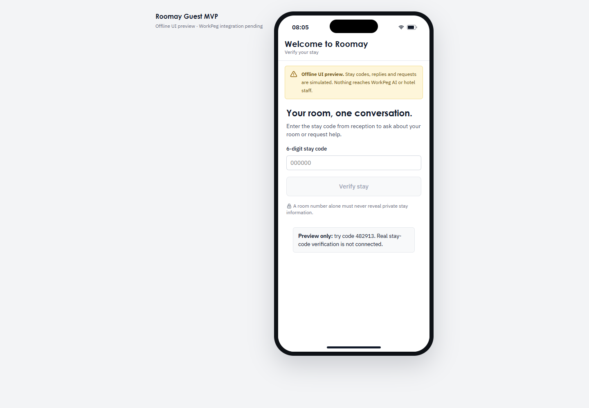

# Roomay Guest MVP preview

This is a standalone React/Vite guest-access UI, independent from `apps/web` and its prototype store. Its default guest-access adapter fails closed because a reviewed trusted verification service is not connected. In development, the prior synthetic stay-code/conversation/request journey is available only as an explicitly selected offline preview; it never establishes an authenticated session.



## Run locally

From this directory:

```sh
npm ci
npm run dev
```

Open `http://127.0.0.1:5173/` or `http://127.0.0.1:5173/#/guest/mvp`. Both URLs render the same access screen. Guest verification is unavailable and the page directs guests to reception until a trusted server adapter is approved and connected. In development only, select **Open the offline UI preview** to inspect the earlier simulation. Its `482913` demonstration code, room, deterministic replies, and saves are fixtures and are never used as authenticated guest access. `?stay=ended`, `?preview=fail`, `?preview=unknown`, and `?preview=offline` exercise preview-only states.

| Command | Purpose |
|---|---|
| `npm run typecheck` | TypeScript checks |
| `npm run lint` | ESLint |
| `npm run build` | Regenerate used icon exports, typecheck, and build to `dist/` |
| `npm run preview` | Serve the production build |

## Preview boundaries

All stay codes, room details, deterministic replies, triage, saves, and tracking shown here are simulation fixtures held in the browser session. They do not verify a real guest, read WorkPeg tables, call WorkPeg AI, notify staff, or create operational hotel records. No WorkPeg integration or credentials are included. Keep this preview out of a hotel release until verified stay access and trusted chat/action integrations are implemented and end-to-end verified.

## Layout

- `src/main.tsx`, `src/App.tsx`: standalone entry and root/hash-route rendering.
- `src/guestAccess.ts`: typed verification/session-status adapter; the default implementation always fails closed and does not call an unsupported API.
- `src/GuestMvp.tsx`: access gate, session status, expiry/revocation, and reception fallback.
- `src/GuestPreview.tsx`: explicitly selected development-only simulation of stay-code, conversation, review, confirmation, tracking, and preview errors.
- `src/PhoneShell.tsx`: phone frame extracted from the visual reference.
- `src/triage.ts`: deterministic preview-only request classification.
- `src/styles.css`: Roomay visual tokens and the original guest screen styles.
- `scripts/gen-icons.mjs`, `src/icons.js`: app-local generated Tabler exports used by Vite.

The standalone package has its own `package.json` and lockfile. It has no runtime imports from `apps/web`. A future trusted adapter must hold credentials in a server-managed Secure, HttpOnly, SameSite cookie, derive identity from verified challenge evidence, and revalidate active-stay scope on protected actions. The UI does not store session tokens in browser storage or URLs.
