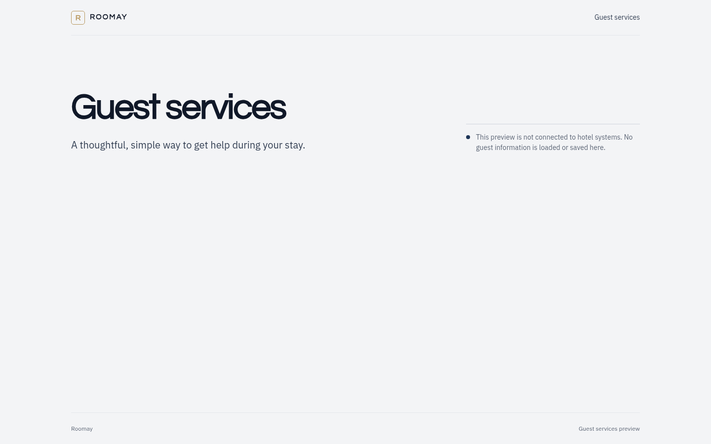

# Roomay Guest Web

Independent Next.js App Router foundation for guest-facing pages. The initial
page is a disconnected preview shell; it does not load guest or hotel data and
does not submit booking or service requests.



## Development

From the repository root with Node.js 24 and pnpm 11.25.0:

```bash
pnpm install
pnpm --filter @roomay/guest-web dev
```

The development server runs at `http://localhost:3000`.

## Checks

```bash
pnpm --filter @roomay/guest-web lint
pnpm --filter @roomay/guest-web typecheck
pnpm --filter @roomay/guest-web test
pnpm --filter @roomay/guest-web build
```

`apps/guest-web` is the sole initial package in the root pnpm workspace.
`apps/web` remains the original Vite prototype and keeps its existing npm
manifest and lockfile. The two applications can be installed and developed
independently; the pnpm workspace does not take ownership of the prototype.

## Structure

```text
src/
  app/                    Next.js routes and root document
  components/             Shared accessible app shell
  features/home/           Guest-facing entry feature and test
  styles/                  Guest app tokens and Tailwind entry stylesheet
  test-setup.ts            Shared Vitest matchers
vitest.config.mts          Isolated frontend test configuration
```

The small token subset in `src/styles/globals.css` uses the same brand colors,
fonts, and corner radii as the v3 reference at `apps/web/src/styles.css`. It is
kept local to avoid coupling the independent Next.js build to Vite-only CSS.
Guest flows can move incrementally from `apps/web/src/mobile.tsx`; staff,
manager, reception, docs and component-sheet screens remain design references
for the native Workpeg UI.

## Why `apps/guest-web`

PR #77 established `apps/web` as the designer's complete Figma-derived Vite
prototype, with its own React code, design assets, synthetic store, npm
manifest and `package-lock.json`. Replacing that occupied directory with a
Next.js scaffold would destroy the reference and mix production guest routing
with synthetic staff/manager screens. `apps/guest-web` lets us create the
requested Next.js/pnpm foundation without changing any prototype source or
lockfile. It also gives future migration work an explicit guest-only boundary;
the existing staff product remains the native Workpeg Python UI.

## Product boundary

The preview banner is intentional. No UI here is connected to Workpeg or a
hotel backend. Booking is not confirmed by this site, and no guest request is
represented as sent to staff. Integrating guest actions requires separately
verified identity, authorization, persistence, reconciliation and delivery.
