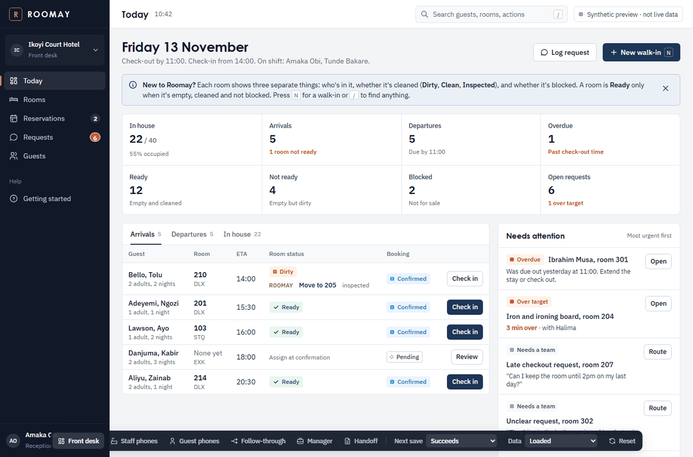
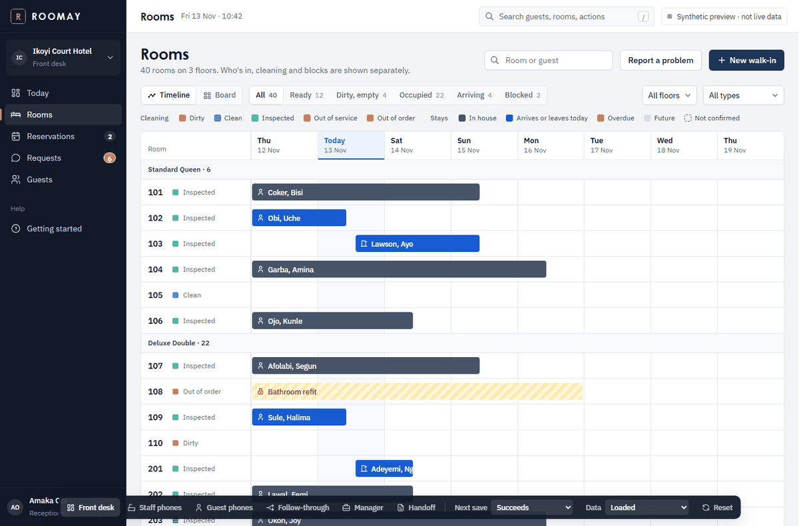
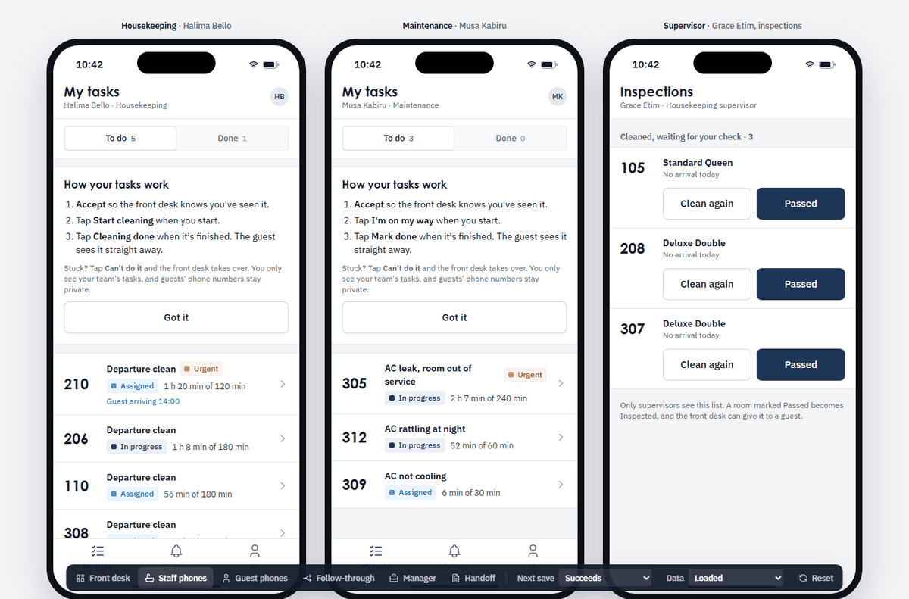
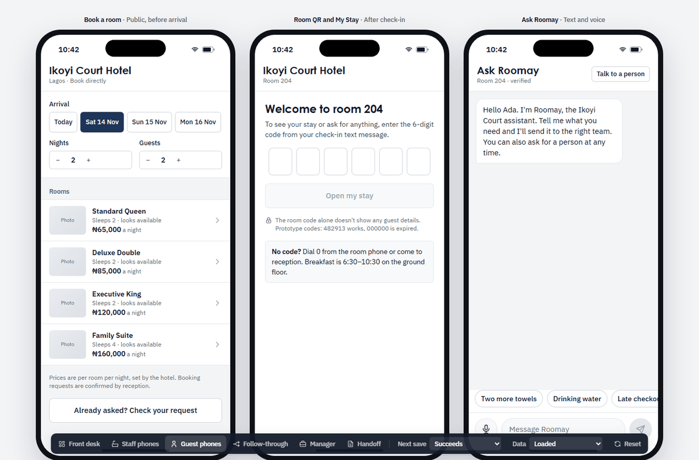

# Roomay web (`apps/web`)

The Roomay frontend from design (WOR-7, WOR-46): the reception desk, staff phones, guest phones and manager screens, built as a working React app so the team can build from real code instead of tracing Figma.

> **Synthetic data only.** Every record here is invented and lives in the browser. Nothing reads or writes Workpeg yet, and the UI says so ("Synthetic preview · not live data"). Wire it to Workpeg rows before anything ships (see [Connecting to Workpeg](#connecting-to-workpeg)). Per `AGENTS.md`, it must not be presented as operational data.

Figma master (same screens, same tokens): https://www.figma.com/design/7Tgnrpl7SQi3QKhmsSJHbF/
Design issues: WOR-7, WOR-24 and WOR-35 to WOR-46 in Linear. Each has a handoff comment.

| Today | Rooms timeline |
|---|---|
|  |  |
| **Staff phones** | **Guest phones** |
|  |  |

## Guest MVP implementation (WOR-17)

The current focused guest flow is at [`#/guest/mvp`](http://localhost:5173/#/guest/mvp):

1. Enter a stay code (local-only preview fixture `482913`; `000000` exercises expiry).
2. Enter the Roomay conversation to ask room questions or describe a service problem.
3. Review an extracted request before deliberately confirming it.
4. Inspect a simulated request in the synthetic browser store and return to chat.

The UI reuses Roomay's mobile shell and design tokens. The previous broader `#/guest` prototype is retained for comparison only. **This is not a production guest authentication flow.** The browser-only verifier and scripted replies cannot establish a real guest session or call WorkPeg AI, and store writes do not reach WorkPeg Tables or receptionist staff. The screen labels these limitations explicitly.

**Next integration gates:** WOR-15 must provide server-verified stay grants, WOR-77/69 must define the trusted chat/action ingress, Umar's WOR-87 implements verified WorkPeg AI behavior, and Yusuf's WOR-65 must return canonical WorkPeg commit/readback evidence before we replace preview messages with real request success. Never put WorkPeg developer credentials, private hotel facts, or a privileged table writer in browser JavaScript.

## Run it

Needs Node 20 or later. From the repo root:

```bash
cd apps/web
npm install
npm run dev        # http://localhost:5173
```

| Command | What it does |
|---|---|
| `npm run dev` | Vite dev server with hot reload |
| `npm run build` | Typecheck, then a production build into `apps/web/dist` (gitignored) |
| `npm run typecheck` | `tsc -b` only |
| `npm run lint` | ESLint |
| `npm run preview` | Serve the production build |
| `npm run icons` | Regenerate `src/icons.js` after importing a new Tabler icon (see below) |

## What's in it

Routes are hash-based, so the app works from any static host.

| Route | Screens | Issue |
|---|---|---|
| `#/reception/today` | Today: 8 KPIs, arrivals / departures / in house, needs attention, first-run help | WOR-37, WOR-24 |
| `#/reception/rooms` | Rooms: Timeline and Board, filters, legend, detail panel | WOR-37 |
| `#/reception/reservations` | Reservations desk: confirm against live rooms, conflict, change dates, new booking, cancel | WOR-39 |
| `#/reception/requests` | Request queue with routing for unclear requests | WOR-37, WOR-40 |
| `#/reception/guests` | Guests | WOR-37 |
| Sheets (from the screens above) | New walk-in → booking saved → check-in checklist, move room, check-out, cancel, log request | WOR-38 |
| `#/staff` | Housekeeping, maintenance (block and safe-to-sell release) and supervisor phones | WOR-40 |
| `#/guest` | Public booking request, room QR and My Stay (invite code), Ask Roomay chat and voice, WhatsApp storyboard (future, not live) | WOR-41, 42, 43 |
| `#/live` | One ticket shown in three views: guest, housekeeping, front desk | WOR-40 |
| `#/one/stay/<room>`, `#/one/staff/<role>` | A single phone, for walkthroughs | WOR-35 |
| `#/manager/overview`, `/team`, `/setup` | Manager overview, roles and permissions, hotel setup | WOR-44 |
| `#/docs` | Handoff docs: product map, status glossary, tokens, conversation states, accessibility audit, copy deck, screen matrix, printable quick start | WOR-35, 45, 46, 24 |
| `#/kit` | Component sheet: every component and state | WOR-36 |

**Prototype dock.** The dark bar at the bottom is a prototype control, not product UI.
- It switches views.
- **Next save** forces the next write to succeed, conflict, fail, return an unknown outcome, duplicate, or be denied (403).
- **Data** simulates loading, no rooms, offline, 401, 403, 400, timeout, partly loaded and out of date.
- **Reset** restores the seed data.

Remove the dock once real data is connected. Prototype codes for My Stay: `482913` works, `000000` is expired.

Front desk shortcuts: `N` new walk-in, `/` or `Ctrl K` search, `Esc` closes.

## Code map

```
src/
  main.tsx            entry: fonts + styles
  App.tsx             hash router, prototype dock, single-phone and docs routes
  data.ts             domain types (Room, Stay, Reservation, Request…), hotel constants, synthetic seed, derived logic
  store.tsx           state + every action (createBooking, checkIn, checkOut, changeRoom, confirm, cancel, editBooking, setHK, setBlock, advance, route, createRequest, requestBooking)
  ui.tsx              shared components: status chips, Sheet, SaveBtn, WriteAlert (one copy for every save outcome), Tabs, Seg, Opt, Stepper, Toasts…
  styles.css          the design system: tokens on :root, components, responsive rules
  reception/          front desk: Reception shell, Today, Rooms, Reservations, Requests, Guests, Panel (detail), Sheets (flows), Command (search)
  mobile.tsx          staff, guest booking, My Stay, Ask Roomay, WhatsApp storyboard
  manager.tsx         manager overview, team and roles, setup
  docs.tsx, kit.tsx   handoff docs and the component sheet
  icons.js            generated re-exports of the Tabler icons in use
scripts/gen-icons.mjs regenerates src/icons.js
```

## Connecting to Workpeg

Every screen already goes through one seam, so wiring real data is contained:

1. **Reads.** Screens read `db` from `useStore()`. Today `db` comes from `seed()` in `data.ts`. Replace it with rows loaded from the Workpeg tables named in the screen matrix (`#/docs/matrix`): `rooms`, `room_types`, `room_blocks`, `reservations`, `stays`, `stay_guests`, `guests`, `service_requests`. Keep the types in `data.ts` as the contract, or generate them from the schema.
2. **Writes.** Every action in `store.tsx` calls `write(fn)`. That one function simulates the network and returns a `WriteResult`: `ok`, or `conflict | fail | unknown | duplicate | denied | offline`. Replace its body with the real Workpeg call and **re-read the saved record before returning `ok`**. The UI already shows the right copy for each result (`WriteAlert` in `ui.tsx`), including "Check status" for unknown outcomes.
3. **Data states.** `data` in the store drives loading, empty, 401, 403, 400, timeout, partly loaded, out of date and offline. Set it from real request outcomes instead of the dock.
4. **Rules that must stay true** (from `AGENTS.md`):
   - A reservation is not a stay. Check-in is a separate step.
   - Occupancy, cleaning and maintenance blocks are separate facts.
   - Confirmations without an atomic inventory primitive stay **Pending confirmation**.
   - Guest access needs the invite code; a QR code, room number or phone number is not authentication.
   - People approve check-in and check-out, room changes, releasing a blocked room, refunds and disclosure. Roomay suggests; staff decide.
5. **Before release:**
   - Remove the dock, the `#/one/*` walkthrough routes and the reset toast.
   - Keep `#/docs` and `#/kit` out of the guest-facing build.
   - No Workpeg keys in browser code.

If the team builds the staff UI as a native Workpeg Python Peg UI instead (see `AGENTS.md`), use this app as the visual and behavioural reference. `#/docs/matrix` maps each screen to its Pegment widgets and lists fallbacks for patterns Pegment doesn't have.

## Design system

- **Type:** headings in Century Gothic (local font), falling back to Questrial (Google Fonts, bundled); interface in IBM Plex Sans; references in IBM Plex Mono.
- **Colour:** neutral surfaces. Navy `#1D3557` is the only action colour. Champagne gold `#B8975E` is for the R mark only.
- **Status colours** follow Mews (Dirty orange, Clean blue, Inspected green, Out of service red, Out of order yellow) and always appear with words.
- **Sizes:** controls 36 / 30px (48px on touch); radius 4 / 6 / 8 / 12; motion only on panels and sheets, off under reduced motion.
- **Contrast:** every text pair passes WCAG AA. The ratios are calculated from the tokens at `#/docs/a11y`.
- **Icons:** `@tabler/icons-react` is aliased to `src/icons.js` in `vite.config.ts`, so Vite doesn't pre-bundle all 5,000+ icons. After importing a new icon, run `npm run icons`.

`AUDIT.md` records the design audit: issue-by-issue coverage, the AI-tell review and what's still open.
