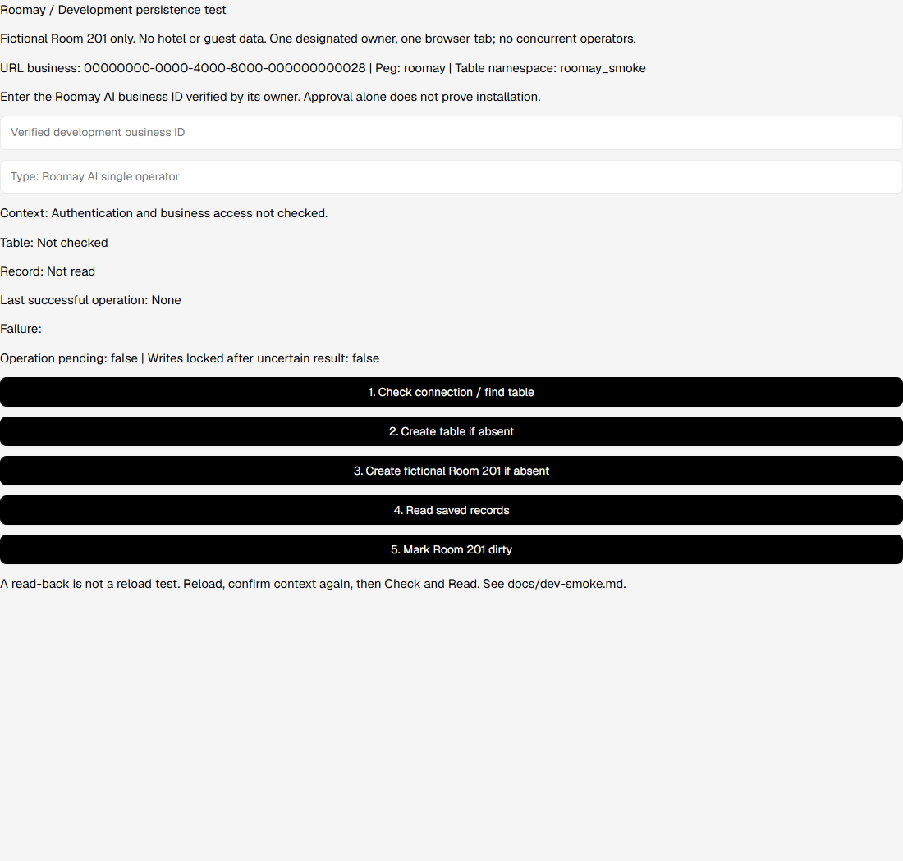

# WOR-28: owner-operated development persistence test

The native UI compiles with SDK **0.149.1**. Offline tests exercise its generated
JavaScript with mocked table helpers. **No authenticated Workpeg request or real
persistence test was performed. WOR-28 and WOR-6 remain In Progress.**

The screen is at `/b/<business_id>/dev-smoke`. Home stays unchanged. There are no
table requests on mount, automatic writes, token fields, functions or additional
databases. No State fields persist locally: after reload the room must be re-read.



Screenshot: local compiled assets, all external traffic blocked. No browser errors
or external requests observed. This is visual evidence, not an authenticated test.

## Verified SDK evidence (November 6, 2026)

- [Tables & rows](https://developers.workpeg.com/docs/latest/tables/): helper
  signatures, custom column ids, namespaces, permissions, alias uniqueness and
  whole-`data` replacement on PATCH.
- [Getting started](https://developers.workpeg.com/docs/latest/getting-started/):
  compilation reads AST without executing Python; localhost and fake-cloud behavior.
- [Data & realtime](https://developers.workpeg.com/docs/latest/data-realtime/):
  async methods, protected requests and catchable non-2xx errors.

Inspected installed files under the SDK's `workpeg/` package:

| Source | Verified behavior |
| --- | --- |
| `ui/compiler/ast_parser.py`, `_WORKPEG_TABLE_HELPERS` | `get_tables([namespace])`, `create_table(table)`, `get_rows(table_uuid, limit=..., offset=...)`, `add_row(table_uuid, row)`, `update_row(table_uuid, row_id, patch)` compile |
| `ui/runtime/workpeg-runtime.js`, table helpers | Active `/b/<business_id>/...`, session-protected requests, Peg namespace and array row responses |
| Same runtime, `_request` / `wpRequest` | Non-2xx throws HTTP-prefixed errors; protected requests may refresh a stale session and retry 401/403 once; no helper timeout/cancellation option |
| `ui/app.py`, `route` / `set_interval` | Route parameters and page-scoped timer callbacks |
| `ui/widgets/layout.py`, `Authenticated` | Mount-time session fetch/redirect; intentionally omitted so this diagnostic's requests remain user-triggered |

The manifest and built HTML declare `roomay`. The SDK supplies `Peg-Namespace`,
session cookies and business URLs. No hand-built API endpoints or developer tokens
are used. Authentication is reported only after protected table access succeeds;
the screen cannot establish the business display name, staff role or installation
status from that response. The owner verifies the business name separately.

Only 401/403 codes are classified using the inspected runtime's HTTP prefix. Raw
exceptions, server bodies, cookies, user payloads and unrelated row fields are not
rendered/logged. Other network/service/malformed-response failures use static text.

## Approved local UI table testing — confirmed by Workpeg support

**Workpeg developer reply (November 6, 2026):** Native `workpeg.*` **Peg UI table helpers can be tested from a local `--fake-cloud` server without publishing or installing a Peg release**. The UI requests run as the signed-in Workpeg user under the business selected by the `/b/<business-uuid>/...` URL. A published/installed release is required when using **backend Functions or custom save hooks**, not for this UI-only development test.

This support clarification supersedes the earlier installation-blocker assumption. **It does not mean any real table persistence has passed yet.** The Tables docs' developer-token installation requirement is distinct from authenticated Peg UI staff-session access. No `WORKPEG_PK` is needed for this UI test.

### Owner-only Windows PowerShell setup (real development API!)

**Check before running:**
- You are using the **Roomay AI development business**, not Personal Account, another hotel or production.
- Its business UUID is verified privately from the Workpeg business context; **do not use the Peg developer portal URL UUID as a guess**.
- Only one authorized developer, one tab and one fictional table/record. Do not share session cookies or screenshot secrets.
- `--fake-cloud` **is not a database mock**: the page talks to Workpeg's real API. The SDK's default binds to the LAN; set `WORKPEG_BIND_HOST=127.0.0.1` to confine the development server to this machine.
- On Windows, the CLI needs **Administrator PowerShell** to append a tagged entry to `hosts`. It also requires **mkcert or OpenSSL** for local HTTPS. Our first owner run failed because neither was installed. Install `mkcert` from a trusted package source and trust its **local development CA** before running Workpeg. Do not enter credentials through an untrusted TLS warning; do not share the local CA private key.

### Resolve Windows HTTPS prerequisite (once per developer machine)

Before rerunning the Workpeg server, install **mkcert**. In Windows PowerShell:

```powershell
winget --version
winget install -e --id FiloSottile.mkcert
```

If WinGet is unavailable but [Chocolatey](https://chocolatey.org/) is already installed, the official Workpeg/mkcert docs also support `choco install mkcert`. Otherwise use the [official mkcert releases](https://github.com/FiloSottile/mkcert/releases); do not download certificate tools from untrusted mirrors.

**Open a fresh Administrator PowerShell after installing** (so PATH refreshes), then:

```powershell
mkcert -version
mkcert -install
```

The second command installs a **locally trusted development root CA** on your machine. Approve only the expected operating-system trust prompt. Keep `rootCA-key.pem` private; never commit or share it. If the executable is not found after installation, close and reopen the terminal and check `Get-Command mkcert` before proceeding.

From the existing local repo root (where `workpeg.json` and `ui/` exist):

```powershell
cd C:\Users\HomePC\Desktop\roomay-workspace\roomay
git status
git fetch origin
git switch staging
git pull --ff-only origin staging

# Only after the owner has checked the worktree and dev business:
$env:WORKPEG_BIND_HOST = "127.0.0.1"
& ..\.venv\Scripts\workpeg.exe ui serve ui/ --fake-cloud --peg-namespace roomay
```

If the `workpeg.exe` path is different, activate your existing virtual environment and run `workpeg ui serve ui/ --fake-cloud --peg-namespace roomay`. Do not re-scaffold or generate a token.

Use **the URL printed by the CLI**, generally `https://roomay.dev.workpeg.com`; it may use a different port such as `:8443`. Open that URL **in the same browser profile where you signed in to Workpeg and selected Roomay AI**, append `/b/<verified-Roomay-AI-business-uuid>/dev-smoke`, and confirm the browser shows only the development domain. The hosts mapping may remain on your machine after stopping; see the Workpeg fake-cloud docs for tagged entry cleanup.

Official reference: https://developers.workpeg.com/docs/latest/getting-started/ (Fake cloud section), plus the Workpeg developer's hackathon Discord guidance.

If the CLI fails on hosts/TLS, get the exact sanitized error and fix only that issue; don't publish functions or loosen database permissions as a workaround. For a `401`, verify the signed-in browser session. For `403`, verify the **selected business ID, your staff membership and table grants**. Avoid inventing a publishing requirement for Peg UI helpers.

## Exact owner-operated live persistence test

Use one designated owner/staff account, one tab and no concurrent operators/scripts.
Confirm this is the sole smoke table: a readable list may hide another owner's
records. Never paste any token/credential into the screen.

1. Sign in to Workpeg in the browser and select the **Roomay AI** development business; verify and record its business UUID privately.
2. Start the local fake-cloud server using the safe loopback-bound commands above. Open the **printed local HTTPS domain** (plus the actual port, if any) and navigate to `/b/<verified-business-uuid>/dev-smoke`. Do not guess the UUID from the Peg review page. No published release is required for this UI helper route.
3. Compare the displayed business UUID with the platform's Roomay AI context.
   Enter that UUID and type `Roomay AI single operator`. This is an operator
   safeguard, not an authentication/authorization grant or hardcoded allowlist.
4. Click **Check connection / find table**. Expect a found table or explicitly no
   *visible* table. For 401, sign in again. For 403, verify membership, installation
   and permissions; do not grant public access as a workaround.
5. If absent and the owner confirmed no earlier table exists, click **Create table
   if absent**. Expect `Roomay Dev Smoke`, namespace `roomay_smoke`, permission
   `700`, alias `roomay-dev-smoke-v1`, required text columns `room_number` and
   `status` with matching custom ids. The action checks absence again and verifies
   the created UUID through a fresh lookup.
6. Click **Create fictional Room 201 if absent**. Expect one `201` / `ready` row
   and its integer row ID. Repeat once: it should say already exists without an
   insert. Click **Read saved records** independently.
7. Reload, re-enter context and confirmation, then click **Check** and **Read**.
   Verify the same row ID and `ready` survived reload.
8. Click **Mark Room 201 dirty**. It reads fresh data, preserves every `data` key,
   changes only status and reads back the same row ID. Repeating the action when
   already dirty should send no update.
9. Reload and repeat **Check** / **Read**: same row ID, now `dirty`. Sign out/in
   through the supported platform flow and repeat to verify fresh-session reads.
10. With a second account if available, verify ungranted staff/guest/non-member
    read/write denial using the supported platform access test. **Do not click
    Create as that account**: hidden records do not prove absence. Keep 700; do
    not broaden permissions. Record unavailable second-account testing as blocked.
11. Add redacted evidence to WOR-28 and `docs/workpeg-capabilities.md`: setup method,
    SDK version, table UUID and same row ID across reads/reloads, statuses, UTC
    observation times and actual permission results. Exclude tokens, cookies, user
    identity payloads and production records. Do not mark Done until real tests pass.

## Failure, duplicate and timeout limitations

- Every action discovers the table afresh. The stable alias is documented as
  unique within a business/Peg; collisions fail without retry under another name.
  Multiple visible tables or unexpected identity/schema/permissions stop writes.
- This dedicated table allows zero or one row. `get_rows(limit=2, offset=0)` detects
  overflow; it is not general pagination. A second row, wrong room, malformed ID or
  unexpected status blocks writes. The owner must check for hidden rows/grants.
- The busy flag prevents simultaneous clicks in this page. No atomic row uniqueness
  or compare-and-insert primitive was verified. **One owner/tab only**: another
  process can race the read/insert. This is not a concurrent-safe seeder or adapter.
- Success requires matching read-back. Last success is explicitly historical. A
  failed/malformed write or failed verification locks writes for this page session;
  read-only reconciliation remains possible once the request has settled.
- After about 30 one-second UI timer ticks, all actions lock and the outcome is
  reported unknown. Browser throttling can delay the warning. The SDK has no abort
  support: a timed-out write may still complete. Late results cannot report success
  or start another write. Have the owner establish that requests settled and inspect
  saved data before reloading. **Read first; never blindly retry a timed-out write.**
- Fresh read/merge/PATCH preserves unrelated keys but is not compare-and-swap;
  another writer's changes can be lost. Single-operator scope applies to updates.
  Permission 700 alone does not prove absence of individual grants/hidden records.

## Offline verification

With the pinned SDK environment and Node 24:

```powershell
python -m unittest discover -s tests -v
python -m compileall -q ui function domain tests
workpeg ui build ui/
git diff --check
```

The Python suite includes the 25 hotel tests plus a compiled UI test running 17
Node scenarios. It builds under ignored `build/`, executes actual generated JS and
SDK collection helpers, mocks table responses and forbids fetch. It covers no
mount-time calls, context guards, CRUD, duplicate handling, malformed responses,
401/403, failed writes, nested-data preservation, read-back mismatch and late
timeouts. These mocks verify application behavior, not hosted Workpeg guarantees.
