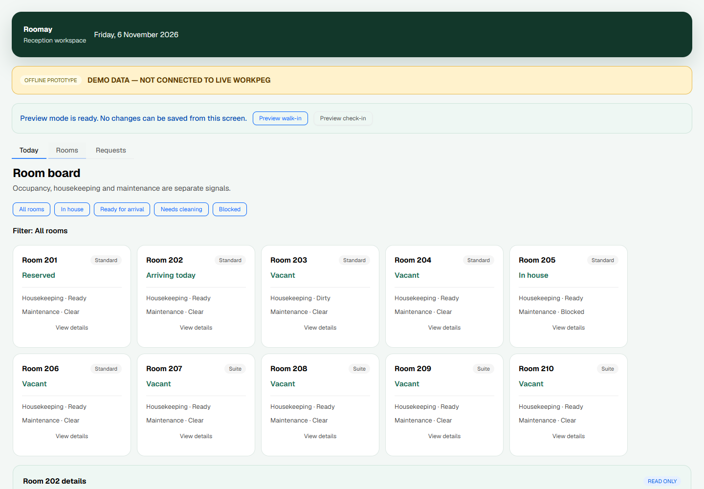
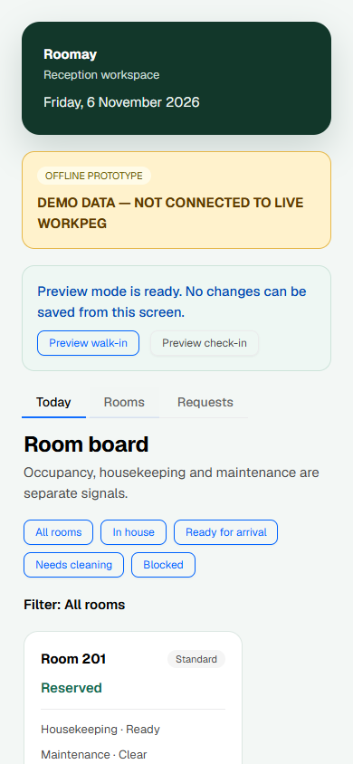

# Archived reception dashboard prototype (WOR-32)

The receptionist dashboard was an **offline, synthetic-data prototype** at
`/demo/reception`; WOR-34 removes that route from the release router. This file
retains historical WOR-32 design evidence only. It was separate from the authenticated
`/b/<business_id>/dev-smoke` diagnostic route.





## What is implemented

- Today metrics for active stays, confirmed arrivals, departures, room readiness,
  housekeeping, maintenance blocks and open service requests.
- A filterable room board with read-only room details. Occupancy, housekeeping
  and maintenance remain distinct fields.
- A service request preview with category, department, priority, status and room
  context.
- Explicit empty-state copy for a day with no departures.
- Clear demo labelling and truthful feedback for preview actions. Assignment and
  resolution controls are disabled; preview walk-in/check-in actions only update
  local explanatory text.
- Responsive wrapping with no horizontal overflow at the tested 390-pixel width.

The browser-friendly projection in `ui/reception.py` is pinned by automated tests
to `domain/reception_demo.py`. That mapper derives its hotel view from
`synthetic_hotel()`, calls the canonical snapshot validator and uses the existing
`room_eligibility()` rule for arrival readiness. It does not implement a second
booking engine.

## Deliberate limits

- The screen does not import or call Workpeg table helpers, make network requests,
  persist actions, authenticate staff, or use credentials.
- Data is fixed to the fictional snapshot date **6 November 2026**. It is not a
  claim about a real hotel or current Workpeg records.
- The UI compiler parses source rather than executing the domain package, so the
  screen contains a literal projection. Tests fail if that literal projection or
  its runtime state drifts from the canonical mapper.
- Workpeg 0.149.1 reads UI source through the platform default encoding on Windows.
  UI strings use ASCII source escapes for non-ASCII punctuation so the compiled
  browser text remains correct.
- Real booking, assignment, check-in, service resolution, authorization and table
  persistence remain future hosted integration work under the relevant issues.

## Local verification

From the repository root with the pinned environment active:

```powershell
python -m unittest discover -s tests -v
python -m compileall -q ui function domain tests
workpeg ui build ui/
workpeg ui serve ui/
```

Open the printed local URL and append `/demo/reception`. No Workpeg business
installation or authenticated session is required because this route is offline.
The screenshots above were captured from the actual compiled browser route, not a
separate design mockup.
