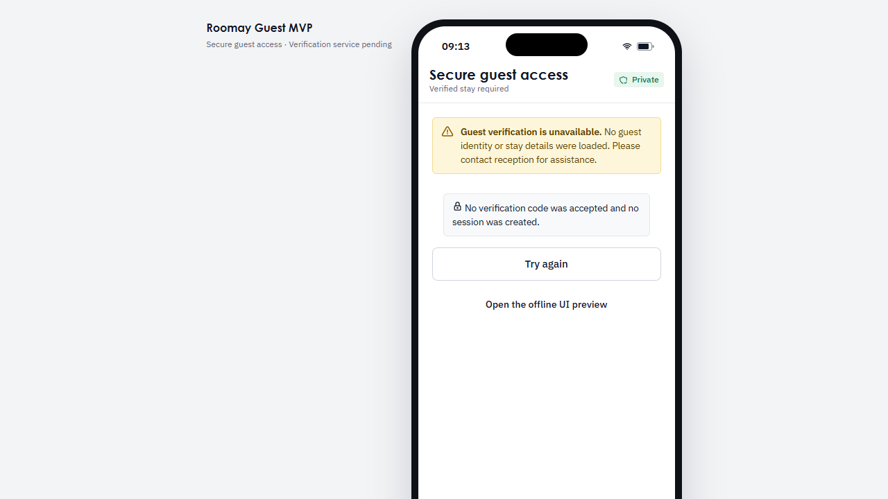

# WOR-15 — Guest access adapter and fail-closed preview

## Scope delivered in this phase

This phase prepares the standalone guest UI and offline security contract; it
does not claim operational guest verification. `apps/guest-mvp/src/guestAccess.ts`
defines a provider-neutral typed adapter for verification, session status, and
logout. The app's default adapter always returns `unavailable` and makes no
network request. A future adapter can be injected without making the React
component a Workpeg client.

The guest journey that uses the demonstration code is isolated in
`GuestPreview.tsx`, dynamically loaded only in Vite development mode after the
user explicitly chooses **Open the offline UI preview**. It is never a
production fallback and returns no authenticated status. Production UI fails
closed with a reception fallback when no trusted server exists. Session status
is rechecked after page load; the frontend contract has no token, guest ID,
business ID, hotel ID, stay ID, or room ID field. It uses no localStorage or URL
for session state. A future server should keep the session in a
Secure/HttpOnly/SameSite cookie and return status without bearer credentials.

`domain/guest_access.py` remains the stay-scoped session authority and
`domain/guest_challenges.py` now adds provider-neutral challenge issuance,
verification, one-time consumption, source/contact throttling, and bounded
attempts. A challenge is bound to the server-resolved guest, business, hotel,
stay, and room. `GuestSessionAuthority` compares that bound stay/room to the
fresh resolution before session issuance, then revalidates active occupancy on
every action. See [the trusted-verification backend phase](wor-15-trusted-verification-backend.md)
for ports, limits, concurrency guarantees, and durable-storage blockers.

## Existing code reused

- `GuestChallengeService` for provider/contact/storage/limiter ports with
  in-memory test adapters only.
- `GuestSessionAuthority` for opaque 15-minute stay-scoped sessions and fresh
  stay resolution on protected use.
- `domain/access_control.py` for business, hotel, guest, active-stay and room
  relationship authorization and safe projections.
- `GuestActionGateway` and the WOR-18 conversation contract for allowlisted
  message/confirm/cancel actions, server-held confirmation handles, and replay
  refusal. Its outputs are still preparation only (`persisted=False`).
- Existing guest backend invitation/session tests cover its synthetic-only
  cookie, expiry, revocation, rate-quota and request flows; that backend is not
  wired to this React app and remains guarded by local-only configuration.

The merged [WOR-77 PR #86](https://github.com/Winathons/roomay/pull/86) defines
`roomay.guest-mvp.v1` request/action projections. It does not define a public
WorkPeg API. Guest verification and session issuance remain a separate boundary
from those request/action contracts.

## WorkPeg integration gate

The installed `workpeg==0.152.0` and current official documentation do not
provide a verified public guest challenge, guest-session, or browser-to-Function
authentication path:

- Workpeg's [OIDC documentation](https://developers.workpeg.com/docs/latest/sign-in-with-workpeg/)
  describes identity for registered relying-party applications;
  client registration and HTTPS callback are required. A Workpeg business
  identity is not proof of hotel guest/stay ownership, and OIDC by itself grants
  no Tables permissions.
- Workpeg [Functions](https://developers.workpeg.com/docs/latest/functions/)
  are invoked by the platform as internal table hooks. Their documentation
  describes a backend developer token for access only
  to tables in that Peg's namespace, not a guest credential or general read of
  staff-owned hotel records. That key must never be shipped to React.
- Workpeg [Tables](https://developers.workpeg.com/docs/latest/tables/)
  require authenticated business staff for table endpoints. Current hotel
  tables remain owner-only (`700`); WOR-28/29 have not verified
  guest-safe Workpeg reads or least-privilege staff write/readback. WOR-69
  records the remaining registered OIDC client, source-of-truth, authorization,
  and hosted guest-to-staff acceptance gates. WOR-65 depends on WOR-15 and the
  shared request contract for the canonical request/audit bridge.
- `backend/app.py` contains local engineering invitation and request routes,
  but the ASGI entry point refuses by default, the active-stay reader is not a
  Workpeg guest reader, and no guest session-status route is defined. It uses
  the dormant isolated PostgreSQL prototype, not the owner-approved Workpeg
  Tables source of truth. The React app therefore does not call it.

Do not add speculative endpoints or activate that prototype. A later reviewed
integration must obtain an approved guest challenge/invitation issuer, bind
verified proof to a server-resolved active stay, protect a short-lived opaque
session with server-managed cookies/storage, revalidate before sensitive
actions, enforce durable rate limits and replay/revocation, and prove
authorization against the canonical Workpeg source. Until those capabilities
and owner/vendor acceptance exist, production guest access remains unavailable
and the UI directs the guest to reception.

## Verification limits

Challenge, rate-limit, session, and revocation state use bounded in-memory
test adapters; process restart loses that state. Thread-level race tests prove
one successful challenge consume within a process. They do not prove a real
provider, distributed rate limiting, durable replay protection, Workpeg tables,
real contacts, or hosted guest data access.

## Browser evidence

The fail-closed screen was opened at both `/` and `/#/guest/mvp` on the local
Vite server. Both returned the same rendered access gate. The browser console
had zero errors and warnings, and the only static request was the favicon
(HTTP 200); the adapter made no guest API request.

